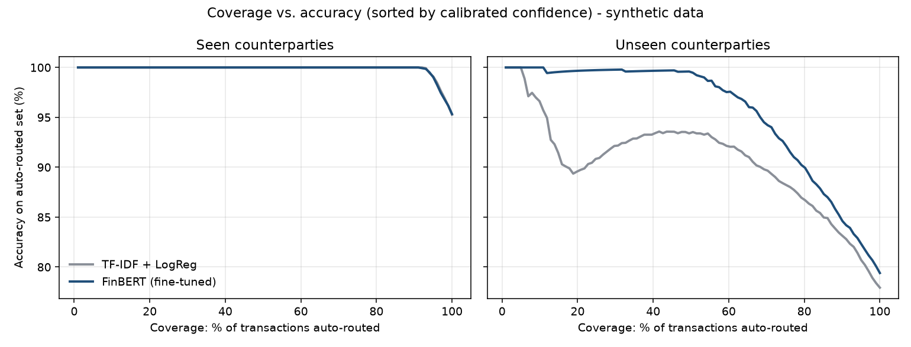

# finbert-transaction-classifier

Fine-tuning **FinBERT** (Hugging Face `transformers`) to classify small-business bank-transaction
descriptors into 12 cash-flow categories, with **confidence-threshold auto-routing**. Confident
predictions are posted automatically and the rest go to a human-review queue.

> **Data disclaimer.** All data is **synthetic**, produced by `txnclf/data.py`. Counterparty strings are
> invented or generic processor-style descriptors. Nothing here comes from a real bank, customer, employer or
> client system, and the metrics below describe this synthetic benchmark only.

## Problem

Underwriting a small business from its bank statements starts with labelling every transaction: payroll,
rent, loan repayment, merchant-cash-advance (MCA) remittance, NSF fee, card-processor revenue and so on.
Descriptors are short, truncated, noisy and full of counterparties the model has never seen. A useful
classifier has to be accurate, and its **confidence must also be trustworthy**, so that only the uncertain
cases reach a human.

Categories: `payroll, rent, loan_repayment, mca_remittance, nsf_fee, card_revenue, customer_payment,
transfer, utilities, tax_payment, supplier_payment, insurance`.

## Data (synthetic)

| Split | Rows | Counterparties |
|---|---|---|
| train | 8,000 | "seen" pool |
| val | 1,500 | "seen" pool (used for early checks, temperature and threshold selection) |
| test_seen | 1,500 | "seen" pool, new rows |
| **test_unseen** | 1,500 | **held-out counterparties never seen in training** (about 25% of each category's names) |

The generator adds realistic mess: bank prefixes (`ACH DEBIT`, `POS PURCHASE`, `WEB PMT`), reference numbers,
dates, store numbers, 40-character truncation, random casing, character typos, and a 7% share of
**low-signal generic descriptors** (`ELECTRONIC PAYMENT`, `ONLINE PAYMENT THANK YOU`) that cap achievable
accuracy. Model input is `"{DEBIT|CREDIT} {amount} | {descriptor}"`.

## Approach

1. **Baseline:** TF-IDF character n-grams (2-5) + logistic regression (`txnclf/baseline.py`).
2. **FinBERT:** `ProsusAI/finbert` (BERT-base, 109M params). Its 3-class sentiment head is replaced by
   a 12-class head; 3 epochs, lr 3e-5, batch 32, max_len 48 (`txnclf/train.py`, HF `Trainer`).
3. **Calibration:** temperature scaling fitted on validation NLL; ECE reported before and after.
4. **Routing:** on validation, choose the *lowest* confidence threshold whose auto-routed accuracy meets a
   target (98% / 99% / 99.5%), freeze it, and apply it to both test splits (`txnclf/routing.py`).

## Results (measured on this machine, Apple M-series via PyTorch MPS)

FinBERT fine-tuning took **249 s** for 3 epochs on MPS. No GPU is needed: on CPU expect roughly 15-30 minutes.

### Headline metrics

| Model | Split | Accuracy | Macro-F1 | ECE raw | ECE temp-scaled |
|---|---|---|---|---|---|
| TF-IDF + LogReg | test_seen | 0.953 | 0.955 | 0.025 | 0.013 |
| TF-IDF + LogReg | test_unseen | 0.779 | 0.791 | 0.150 | 0.069 |
| FinBERT (fine-tuned, seed 42) | test_seen | 0.953 | 0.958 | 0.019 | 0.015 |
| FinBERT (fine-tuned, seed 42) | test_unseen | 0.794 | 0.780 | 0.054 | 0.082 |

FinBERT seed variance (3 fine-tuning runs, seeds 42/43/44):

| Split | Mean accuracy | Std dev |
|---|---|---|
| test_seen | 0.955 | 0.002 |
| test_unseen | **0.806** | 0.011 |

### Coverage vs. accuracy



### Auto-routing (threshold fixed on validation, applied to test)

| Model | Split | Target (val) | Threshold | Auto-routed | Auto-routed accuracy | To human review |
|---|---|---|---|---|---|---|
| TF-IDF + LogReg | test_seen | 99.0% | 0.472 | 96.2% | 98.34% | 3.8% |
| TF-IDF + LogReg | test_unseen | 99.0% | 0.472 | 82.7% | 85.81% | 17.3% |
| FinBERT | test_seen | 99.0% | 0.627 | 95.0% | 99.02% | 5.0% |
| FinBERT | test_unseen | 99.0% | 0.627 | 84.3% | 87.67% | 15.7% |
| FinBERT | test_seen | 99.5% | 0.771 | 93.6% | 99.64% | 6.4% |
| FinBERT | test_unseen | 99.5% | 0.771 | 78.9% | 90.36% | 21.1% |

The full table, including the 98% target, is in [`reports/results.md`](reports/results.md).

### What the numbers say

- **On familiar counterparties a cheap baseline is as good as FinBERT** (95.3% vs 95.3%). Within the
  training distribution the transformer does not earn its compute.
- **On new counterparties FinBERT generalises better.** Accuracy is 80.6% ± 1.1 across seeds vs 77.9% for the
  baseline, and the bigger difference is in **confidence quality**. FinBERT's highest-confidence half of
  unseen transactions is about 99.6% accurate, while the baseline's is about 93%: the baseline is
  *confidently wrong* on unseen names (raw ECE 0.150 vs 0.054). A routing system depends on exactly that
  property.
- **Thresholds tuned on familiar data do not transfer under drift.** A threshold that delivers 99% on seen
  counterparties delivers only 86-88% on unseen ones for *both* models. In production that argues for
  monitoring auto-routed accuracy by sampling, re-fitting thresholds on recent reviewed data, and tracking the
  new-counterparty rate as a drift signal.
- Temperature scaling helped the baseline but slightly *worsened* FinBERT's ECE on unseen data. Calibration
  fitted in-distribution is not guaranteed out of distribution either.

## How to run

```bash
python -m venv .venv && source .venv/bin/activate
pip install -r requirements.txt

python -m txnclf.data                 # synthetic splits -> data/
python -m txnclf.baseline             # TF-IDF + LR -> artifacts/baseline/
python -m txnclf.train                # FinBERT fine-tune -> artifacts/finbert/ (about 4 min on Apple MPS)
python -m txnclf.train --seed 43 --out artifacts/finbert_s43   # optional: extra seeds
python -m txnclf.report               # tables + charts -> reports/
pytest -q                             # unit tests (generator, routing, calibration)

# classify + route ad-hoc descriptors
python -m txnclf.predict --direction DEBIT --amount 1450 "ACH DEBIT SBA LOAN PMT 0042" "ELECTRONIC PAYMENT"
# {"label": "loan_repayment", "confidence": 0.9971, "route": "AUTO"}
# {"label": "supplier_payment", "confidence": 0.4051, "route": "HUMAN_REVIEW"}
```

To try a smaller model: `python -m txnclf.train --model distilbert-base-uncased --out artifacts/finbert`.

## Repo layout

```
txnclf/data.py       synthetic generator (seen/unseen counterparty split)
txnclf/baseline.py   TF-IDF + logistic regression
txnclf/train.py      Hugging Face fine-tuning (Trainer)
txnclf/routing.py    temperature scaling, ECE, threshold selection, coverage curves
txnclf/report.py     metrics.json, results.md, charts
txnclf/predict.py    CLI inference + routing decision
tests/               pytest suite
reports/             generated results (committed)
```

## Limitations

- Synthetic descriptors are cleaner and more template-like than real bank data, so absolute accuracies are
  not a forecast of production performance.
- Only the descriptor, direction and amount are used. Real systems add counterparty history, recurrence
  patterns and account context.
- The routing target is a point estimate on 1,500 validation rows, so its confidence interval matters at the
  99%+ level.

License: MIT.
